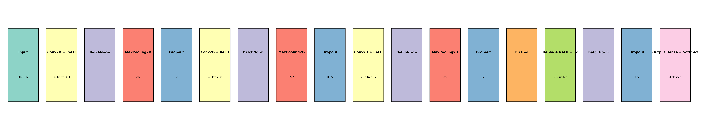
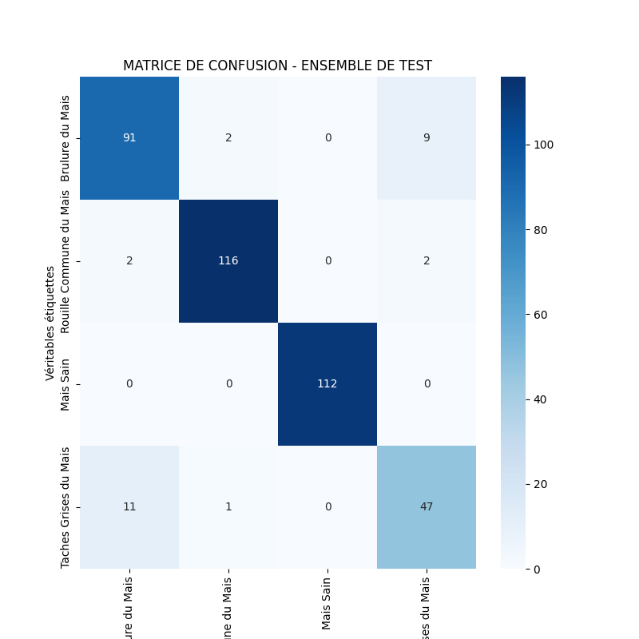
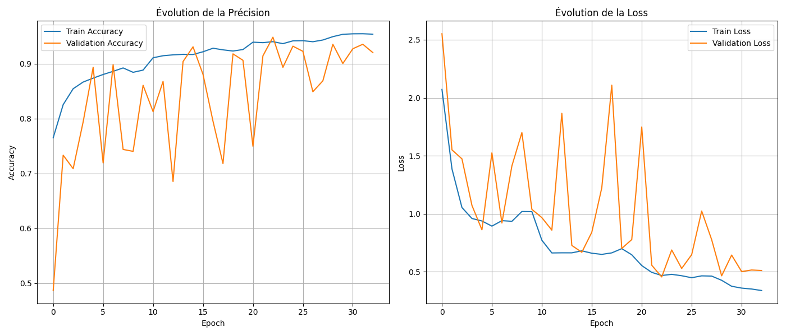

# Détection des maladies du maïs par réseau de neurones convolutif

*Projet réalisé dans le cadre de mon mémoire de licence en informatique, en 2025.*

J’ai consacré ce travail à la reconnaissance de maladies du maïs à partir de photographies de feuilles. Le point de départ était assez concret : certaines maladies présentent des signes visibles, mais ces signes ne sont pas toujours faciles à distinguer à l’œil nu. J’ai donc cherché à voir ce qu’un réseau de neurones convolutif pouvait apprendre de ces images, puis à utiliser ce modèle dans une application Android.

Le projet couvre la préparation des images, l’entraînement du CNN, l’analyse de ses erreurs et la conversion du modèle pour une utilisation sur téléphone. Je conserve aussi un premier notebook d’expérimentation : il permet de voir comment le travail a évolué avant la version retenue dans mon mémoire.

## Les images utilisées

J’ai travaillé avec quatre catégories :

- **Brûlure du maïs**
- **Rouille commune du maïs**
- **Maïs sain**
- **Taches grises du maïs**

Le jeu de données utilisé pour le modèle final compte **10 104 images** :

| Ensemble | Images | Rôle |
| --- | ---: | --- |
| Entraînement | 8 856 | Apprentissage des caractéristiques visuelles |
| Validation | 855 | Suivi de l’entraînement et choix du modèle |
| Test | 393 | Évaluation finale sur des images mises de côté |

Les images ont été ramenées à **150 × 150 pixels** et leurs valeurs ont été normalisées entre 0 et 1. Pour l’entraînement, j’ai utilisé l’augmentation de données (rotations, décalages, zooms, variations de luminosité et retournements horizontaux). J’ai également appliqué des poids de classe afin de tenir compte des différences d’effectifs entre catégories.

Les images originales ne sont pas intégrées à ce dépôt. Le notebook utilise la structure `DataSets/train`, `DataSets/valid` et `DataSets/test` sur Google Drive ; il faut disposer de ces données, avec les mêmes noms de classes, pour relancer l’entraînement.

## Le CNN que j’ai retenu

Au lieu d’utiliser directement un réseau préentraîné pour la version finale, j’ai construit un CNN avec l’API `Sequential` de Keras. Il comporte trois blocs de convolution (**32, 64 et 128 filtres**), chacun associé à une normalisation, un max-pooling et du dropout. Après l’extraction des caractéristiques, une couche dense de **512 neurones** précède la sortie à quatre classes avec `softmax`.

L’entraînement utilise l’optimiseur **Adam** (taux initial `0.001`) et la perte `categorical_crossentropy`. J’ai suivi la précision et la perte sur les données de validation, avec `EarlyStopping`, `ReduceLROnPlateau` et `ModelCheckpoint` pour conserver la meilleure version enregistrée.



## Ce que donnent les tests

Le modèle retenu a obtenu **93,13 % d’exactitude sur les 393 images de test**, avec une perte de **0,4997**. Ce chiffre est celui de l’évaluation enregistrée dans mon notebook et présentée dans mon mémoire de licence.

Le détail par catégorie est plus instructif que le seul score global :

| Catégorie | Précision | Rappel | F1-score | Images de test |
| --- | ---: | ---: | ---: | ---: |
| Brûlure du maïs | 0,88 | 0,89 | 0,88 | 102 |
| Rouille commune | 0,97 | 0,97 | 0,97 | 120 |
| Maïs sain | 1,00 | 1,00 | 1,00 | 112 |
| Taches grises | 0,81 | 0,80 | 0,80 | 59 |

Les taches grises restent la catégorie la plus difficile à distinguer dans ce test. Les résultats sur le jeu de données ne suffisent pas, à eux seuls, à établir le comportement du modèle sur des photos prises dans d’autres conditions de lumière, de cadrage ou de terrain.





## Du notebook au téléphone

J’ai enregistré le modèle entraîné au format Keras, sous le nom `best_simple_cnn_model.keras`, puis je l’ai converti en **TensorFlow Lite** (`simple_cnn_model.tflite`). Cette version plus légère était destinée à l’application Android *Détecteur de Santé du Maïs*, développée en Java/XML dans le cadre du mémoire. L’application permet de choisir ou prendre une photo et d’afficher la classe prédite.

Ce dépôt contient les deux formats du modèle et la partie Python de mon travail ; il ne contient pas le projet source Android.

## Contenu du dépôt

```text
notebooks/     Notebook du modèle final et de son évaluation
experiments/   Premiers essais de CNN
models/        Modèles Keras et TensorFlow Lite, ordre des classes
results/       Architecture, matrice de confusion, courbes d'entraînement
logs/          Historique CSV de l'entraînement
scripts/       Prédiction sur une image avec le modèle Keras
```

Le fichier `.keras` est stocké avec **Git LFS** en raison de sa taille.

## Essayer une prédiction

Avec Python et les dépendances installées :

```bash
pip install -r requirements.txt
python scripts/predict.py chemin/vers/une_image.jpg
```

Le script utilise le modèle Keras fourni dans `models/`. Il redimensionne l’image à `150 × 150`, applique la même normalisation que pendant l’entraînement, puis affiche les probabilités prédites pour les quatre classes. Pour reprendre l’entraînement ou refaire l’évaluation complète, il faut ouvrir `notebooks/Implementation_memoire.ipynb` dans Google Colab et adapter le chemin des données.

Ce dépôt rassemble la partie expérimentale de mon mémoire : les essais, le modèle choisi, les traces de l’entraînement et les résultats obtenus. Il montre aussi ce qu’il reste à éprouver : la généralisation à des images prises directement dans les champs, hors du jeu de données utilisé pour l’étude.
